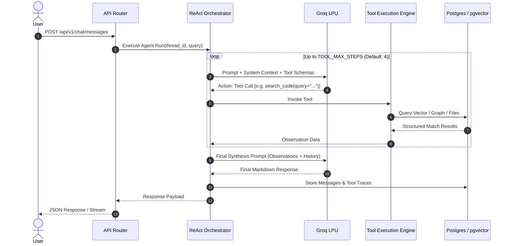

# System Architecture & Technical Specifications

**Product:** RepoWeave  
**Document:** Technical Architecture Specification  
**Version:** 1.2.0  

---

## 1. System Topology & Layers

RepoWeave is structured following a strict unidirectional dependency architecture:

```
[ HTTP Request ]
       │
       ▼
[ FastAPI Middleware ] (CORS, Request Logging, Cookie Authentication)
       │
       ▼
[ API Routers (app/api/v1/endpoints/) ]
       │
       ▼
[ Services Layer (app/services/) ] ──► [ Background Tasks / Worker Pool ]
       │                                     │
       ▼                                     ▼
[ Repositories Layer (app/repositories/) ]   [ Parsing / Embedding / LLM Services ]
       │
       ▼
[ Database Models (SQLAlchemy ORM + pgvector) ]
```

### 1.1 Layer Responsibilities

| Layer | Directory | Responsibilities | Constraints |
|---|---|---|---|
| **API Endpoints** | `app/api/v1/endpoints/` | HTTP status codes, query validation, cookie handling, response formatting. | No direct database queries; must delegate to Services. |
| **Services** | `app/services/` | Business workflows, transaction boundaries, external API calls, AI orchestration. | Stateless where possible; receives dependencies via FastAPI dependency injection. |
| **Repositories** | `app/repositories/` | Low-level database CRUD operations, vector similarity queries, graph lookups. | No HTTP concerns; returns SQLAlchemy models or scalar records. |
| **Models** | `app/models/` | Declarative SQLAlchemy ORM entities with pgvector column definitions. | Clean relational schema, foreign key relationships, indexes. |
| **Schemas** | `app/schemas/` | Pydantic v2 schemas for request validation and response serialization. | Strict typing, input sanitization, field defaults. |
| **Core** | `app/core/` | Configuration (`Settings`), DB session factories, security utilities, logging. | Foundation module imported across all layers. |

---

## 2. Ingestion & AST Parsing Engine

RepoWeave processes raw source code repositories into structured AST representations.

### 2.1 File Filtering & Normalization
During ingestion:
- Binary files, lockfiles, compiled assets, and media formats are excluded.
- Files matching standard ignore lists (`.git`, `node_modules`, `__pycache__`, `.venv`, `dist`, `build`) are skipped.
- Individual files exceeding `MAX_FILE_SIZE_BYTES` (default 1MB) are omitted from deep AST chunking to safeguard worker memory.

### 2.2 Tree-sitter Concrete Syntax Tree (CST) Traversal
RepoWeave initializes Tree-sitter parsers for supported language families:
- **Python:** Identifies `function_definition`, `class_definition`, `decorated_definition`, `import_statement`, `import_from_statement`.
- **JavaScript & TypeScript:** Identifies `function_declaration`, `class_declaration`, `method_definition`, `arrow_function`, `import_statement`, `export_statement`.
- **Go:** Identifies `function_declaration`, `method_declaration`, `type_declaration`, `import_declaration`.
- **C & C++:** Identifies `function_definition`, `class_specifier`, `struct_specifier`, `preproc_include`.

### 2.3 Code Chunking Strategy
- Files under `FILE_CHUNK_WHOLE_FILE_MAX_LINES` (default 200 lines) are retained as coherent whole units when structurally advantageous.
- Files exceeding standard lengths are decomposed along AST symbol boundaries into chunks bounded by `FILE_CHUNK_MAX_LINES` (default 120 lines).
- Chunks preserve parent class/function context, file path headers, and start/end line offsets.

---

## 3. Dependency Graph Extraction

The dependency mapping engine models codebases as directed acyclic and cyclic graphs:

1. **Vertex Resolution (`dependency_nodes`):**
   - Each unique source file represents a vertex.
   - External dependencies (e.g., standard libraries, npm packages, PyPI modules) are resolved into external dependency vertices.
2. **Edge Resolution (`dependency_edges`):**
   - Import statements (`import`, `from ... import`, `require`, `include`) are resolved against repository relative paths.
   - Circular imports and complex module resolutions are tracked via graph traversal depth limiters (`GRAPH_TRAVERSAL_MAX_DEPTH`, default 5).
3. **Frontend Rendering:**
   - Vertices and edges are formatted into `@xyflow/react` compatible nodes and connectors.
   - Interactive UI enables node expansion, dependency path tracing, and immediate code preview.

---

## 4. AI Engine & ReAct Multi-Step Agent

RepoWeave's agent runtime is designed for low-latency code reasoning using Groq Cloud LPUs.

### 4.1 Model Hierarchy & Fallback
- **Primary Model:** `groq/compound-mini` (high throughput, optimized tool calling).
- **Secondary Fallback:** `groq/compound` (for complex structural synthesis).
- **Instruction Fallback:** `meta-llama/llama-4-scout-17b-16e-instruct` (deep context reasoning).

### 4.2 ReAct Orchestration Loop


### 4.3 Tool Definition Suite
The agent has access to 4 deterministic tools:
1. `search_code(query: str, limit: int = 5)`: Executes hybrid vector/keyword search.
2. `read_file(file_path: str, start_line: int = None, end_line: int = None)`: Retrieves source text with line numbers.
3. `get_dependencies(file_path: str)`: Returns inbound and outbound dependency edges for a file.
4. `list_files(directory: str = "")`: Returns file tree structure for navigating directory hierarchies.

---

## 5. Storage & Vector Retrieval Architecture

### 5.1 Relational Storage
PostgreSQL 15+ hosts relational state managed by 11 Alembic migrations:
- User accounts and roles.
- Repository ingestion statuses and branch snapshots.
- Dependency vertices and directional relationships.
- Chat threads, message history, and tool invocation audits.
- Pull request reviews, diff analysis, and repository documentation caches.

### 5.2 Dense Vector Embeddings with pgvector
Code chunk embeddings are persisted in a PostgreSQL `vector(384)` column:
- **Index:** IVFFlat / HNSW indexed for fast approximate nearest neighbor search.
- **Metric:** Cosine distance operator (`<=>`).
- **Hybrid Fusion:** Cosine distance is normalized and combined with SQL `ILIKE` lexical matches.

---

## 6. Frontend Application Architecture

The frontend is built on Next.js 16 with the React 19 App Router:

- **State Management:** TanStack Query v5 handles server state, caching, and optimistic updates.
- **Graph Visualization:** `@xyflow/react` (React Flow 12) renders the interactive dependency graph with custom node components.
- **Markdown & Code Rendering:** `react-markdown` with `remark-gfm` and syntax highlighting for chat responses and repository documentation.
- **Styling:** Tailwind CSS v4 with custom utility classes and dark mode compatibility.
- **API Proxy:** In production, browser requests route through Next.js `/api/*` rewrites to the backend API to guarantee same-origin cookies and bypass cross-origin browser security restrictions.
